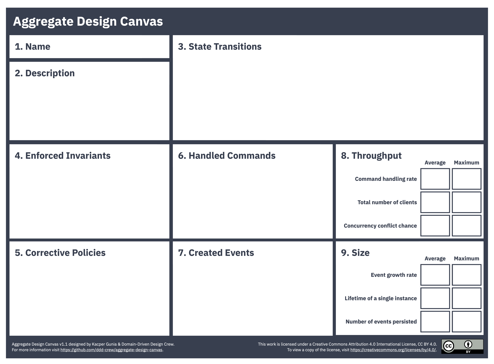
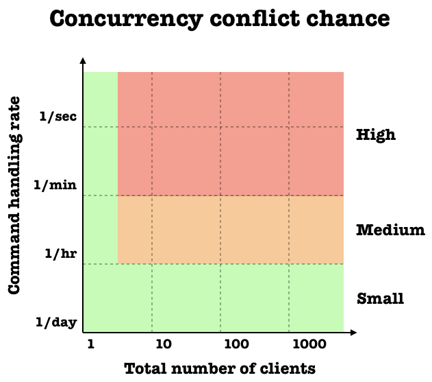
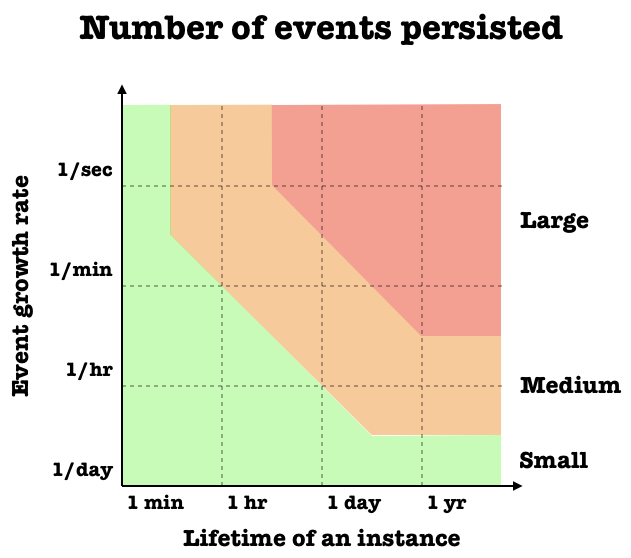
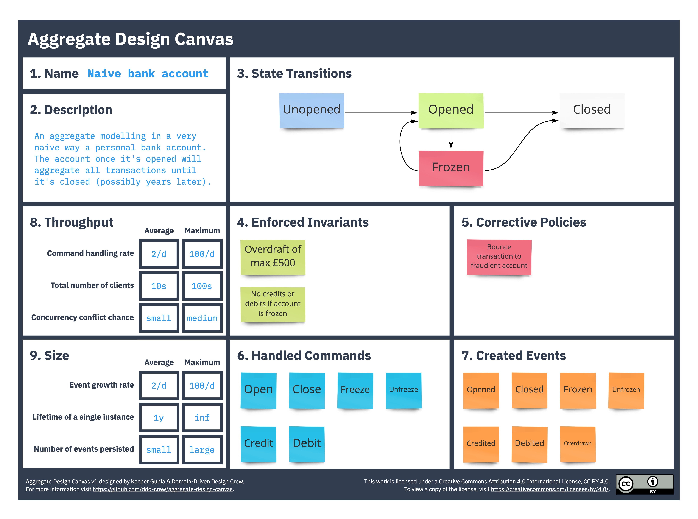

# Aggregate Design Canvas

> **Nota sobre os recursos visuais:** o canvas, os gráficos de avaliação e os arquivos editáveis reutilizados nesta tradução permanecem em inglês. Na primeira ocorrência de um rótulo visual relevante, o termo original é apresentado entre parênteses para facilitar sua identificação nos recursos.

O **Aggregate Design Canvas** é uma ferramenta de modelagem destinada a atividades de modelagem de domínio no nível de design.

Um agregado (*aggregate*) é um padrão de ciclo de vida descrito originalmente por Eric Evans. Neste contexto, entendemos um agregado como um grafo de objetos que constitui um limite de consistência (*consistency boundary*) para as políticas do domínio. Dependendo de seu design, podemos garantir essas políticas, transformando-as em invariantes, ou precisar adotar políticas corretivas. Por isso, é importante projetar bem os limites dos agregados, pois eles afetam os comportamentos modelados no domínio.

O canvas sugere uma ordem de preenchimento que ajuda a discutir, de forma iterativa, diferentes aspectos do design do agregado.

### Arquivos para download

Versão 1.1:

- [Aggregate Design Canvas v1.1 — PNG em inglês](../../resources/aggregate-design-canvas-v1.1.png "Aggregate Design Canvas v1.1 (png)")
- [Aggregate Design Canvas v1.1 — PDF em inglês](../../resources/aggregate-design-canvas-v1.1.pdf "Aggregate Design Canvas v1.1 (pdf)")
- [Aggregate Design Canvas v1.1 — backup do quadro do Miro em inglês](../../resources/aggregate-design-canvas-v1.1.rtb "Aggregate Design Canvas v1.1 (miro board backup)")
- [Aggregate Design Canvas v1.1 — SVG do Draw.io em inglês](../../resources/aggregate-design-canvas-v1.1.drawio.svg "Aggregate Design Canvas v1.1 (drawio svg)")
- [Aggregate Design Canvas v1.1 — arquivo do Excalidraw em inglês](../../resources/aggregate-design-canvas-v1.1.excalidraw "Aggregate Design Canvas v1.1 (Excalidraw)")

Versão 1.0:

- [Aggregate Design Canvas v1 — JPG em inglês](../../resources/aggregate-design-canvas-v1.jpg "Aggregate Design Canvas v1 (jpg)")
- [Aggregate Design Canvas v1 — PDF em inglês](../../resources/aggregate-design-canvas-v1.pdf "Aggregate Design Canvas v1 (pdf)")
- [Aggregate Design Canvas v1 — backup do quadro do Miro em inglês](../../resources/aggregate-design-canvas-v1.rtb "Aggregate Design Canvas v1 (miro board backup)")
- [Aggregate Design Canvas v1 — SVG do Draw.io em inglês](../../resources/aggregate-design-canvas-v1.drawio.svg "Aggregate Design Canvas v1 (drawio svg)")

## Como usar

### 1. Nome (*Name*)

Dê um bom nome ao agregado. Em alguns domínios, faz sentido incluir no nome a duração de um ciclo ou alguma outra indicação do tempo de vida do agregado.

### 2. Descrição (*Description*)

Resuma as principais responsabilidades e o propósito do agregado. Também é recomendável registrar por que esses limites foram escolhidos e quais compromissos de design (*trade-offs*) foram assumidos em comparação com outras alternativas.

### 3. Transições de estado (*State Transitions*)

Normalmente, o agregado passa por transições explícitas de estado que afetam a maneira como ele pode ser utilizado. Transições em excesso podem indicar que os limites do processo não foram modelados adequadamente e que o agregado pode ser dividido. Transições excessivamente ingênuas ou simples podem indicar um agregado anêmico, cuja lógica foi transferida para serviços.

Nesta seção do canvas, liste os estados possíveis ou desenhe um pequeno diagrama de transição.

### 4. Invariantes impostas (*Enforced Invariants*) e 5. Políticas corretivas (*Corrective Policies*)

Uma das principais responsabilidades do agregado é garantir as invariantes de negócio. Essas invariantes protegem a lógica do negócio. Listar as principais nesta seção ajuda o time a chegar a um entendimento comum sobre as responsabilidades do agregado. Um grande número de invariantes impostas pode indicar alta complexidade local na implementação do agregado.

Ao alterar os limites do agregado e relaxar algumas invariantes — por exemplo, para reduzir a possibilidade de conflitos de concorrência — pode ser necessária lógica de negócio adicional para corrigir determinadas inconsistências. No contexto deste canvas, essa lógica é chamada de **política corretiva**.

Um grande número dessas políticas pode indicar que a lógica de negócio foi deslocada para fora do agregado, aumentando a complexidade da implementação.

Registrar no canvas tanto as invariantes quanto as políticas corretivas torna explícitos os compromissos de design e ajuda a avaliar se os limites escolhidos são adequados.

### 6. Comandos tratados (*Handled Commands*) e 7. Eventos criados (*Created Events*)

Nesta seção, liste todos os comandos que o agregado é capaz de tratar e todos os eventos que serão criados como resultado. Pode ser útil conectar comandos e eventos para validar se nenhum elemento importante foi esquecido.

### 8. Vazão (*Throughput*)

O objetivo desta seção é estimar a probabilidade de uma única instância do agregado se envolver em conflitos de concorrência, isto é, quando dois ou mais clientes concorrentes tentam realizar alterações ao mesmo tempo.

Para cada métrica, estime os valores médio (*Average*) e máximo (*Maximum*). Isso ajuda a analisar os casos extremos, que frequentemente levam à reavaliação dos limites.

A métrica **taxa de tratamento de comandos (*Command handling rate*)** descreve a frequência com que o agregado processa novos comandos. Já a métrica **número total de clientes (*Total number of clients*)** indica quantos clientes provavelmente emitirão esses comandos.

Por exemplo, quando um agregado representa uma cesta de compras de um site, provavelmente haverá apenas um cliente enviando comandos para essa cesta. Em comparação, um agregado que representa um sistema de reservas para uma conferência pode ter dezenas ou centenas de clientes tentando reservar ingressos.

#### Gráfico de avaliação da possibilidade de conflitos de concorrência

Representar essas métricas em um gráfico fornece uma estimativa aproximada da **possibilidade de conflito de concorrência (*Concurrency conflict chance*)**, que é o resultado que buscamos avaliar.

Plotar os valores médio (*Average*) e máximo (*Maximum*) de diferentes alternativas permite discutir explicitamente os compromissos relacionados à vazão. De modo geral, buscar uma pequena possibilidade de conflito proporciona uma experiência melhor ao cliente, mas também aumenta a complexidade da implementação.

Em outras palavras, agregados maiores apresentam maior possibilidade de conflitos de concorrência, mas exigem menos políticas para corrigir dados inconsistentes.

### 9. Tamanho (*Size*)

A última seção do canvas ajuda a estimar o tamanho hipotético do agregado. Nesse caso, o tamanho é medido pelo número de eventos por instância do agregado.

Dependendo de como o domínio é modelado, os eventos podem ter granularidade fina ou grossa, e o tamanho de cada evento também influencia o resultado.

Por exemplo, um evento `OrderCreated` pode conter vários `LineItems`, ou esses itens podem ser modelados como eventos `LineItemAdded` separados. Com eventos de granularidade grossa, o tamanho total do agregado será maior, mesmo que a quantidade de eventos seja pequena.

A métrica **taxa de crescimento de eventos (*Event growth rate*)** deve estimar quantos eventos são adicionados a uma única instância do agregado. O **tempo de vida de uma única instância (*Lifetime of a single instance*)** indica por quanto tempo a instância existirá. A combinação dessas duas métricas ajuda a estimar o **número de eventos persistidos (*Number of events persisted*)**, isto é, quantos eventos serão acumulados e recuperados quando for necessário processar um novo comando.

#### Gráfico de avaliação do tamanho do agregado

Uma quantidade média ou grande de eventos pode prejudicar a experiência do cliente e tornar lento o tratamento de comandos. Felizmente, na maioria dos casos isso pode ser atenuado com o uso de *snapshots*.

Outro aspecto importante são as instâncias de longa duração, potencialmente infinitas. Elas podem causar problemas no arquivamento de dados e gerar fluxos de eventos que crescem continuamente. Por isso, geralmente é uma boa heurística limitar o agregado a um período específico, como um período de faturamento.

## Recursos adicionais

- [Domain-Driven Design: A mathematical model for process-oriented Aggregates pt. I](https://medium.com/@tPl0ch/domain-driven-design-a-mathematical-model-for-process-oriented-aggregates-pt-i-6aecc8957865)
- [Modelling aggregates with "Aggregate Design Canvas"](https://domaincentric.net/blog/modelling-aggregates-with-aggregate-design-canvas)
- [Modelling Aggregates: Invariants vs Corrective Policies](https://domaincentric.net/blog/modelling-business-rules-invariants-vs-corrective-policies)
- [Domain Events vs. Event Sourcing](https://www.innoq.com/en/blog/domain-events-versus-event-sourcing)

## Exemplos

### Conta bancária ingênua (*Naive bank account*)

## Colaboradores

Agradecemos a todos os [colaboradores atuais e futuros](https://github.com/ddd-crew/aggregate-design-canvas/graphs/contributors), assim como a [Mathew McLoughlin](https://github.com/mat-mcloughlin) e [Marijn Huizendveld](https://github.com/marijn), que contribuíram para o Aggregate Design Canvas.

O canvas foi inspirado pelo [Bounded Context Canvas em português brasileiro](https://github.com/ddd-crew/bounded-context-canvas/blob/main/translations/pt-br/README.md).

## Contribuições e feedback

O Aggregate Design Canvas está disponível gratuitamente para uso. Comentários e ideias para aprimorar o canvas ou criar novas versões também são bem-vindos.

Você também pode enviar um pull request com seus próprios exemplos.

[![CC BY 4.0][cc-by-shield]][cc-by]

Este trabalho está licenciado sob a [Licença Internacional Creative Commons Atribuição 4.0][cc-by].

[![CC BY 4.0][cc-by-image]][cc-by]

[cc-by]: http://creativecommons.org/licenses/by/4.0/
[cc-by-image]: https://i.creativecommons.org/l/by/4.0/88x31.png
[cc-by-shield]: https://img.shields.io/badge/License-CC%20BY%204.0-lightgrey.svg
